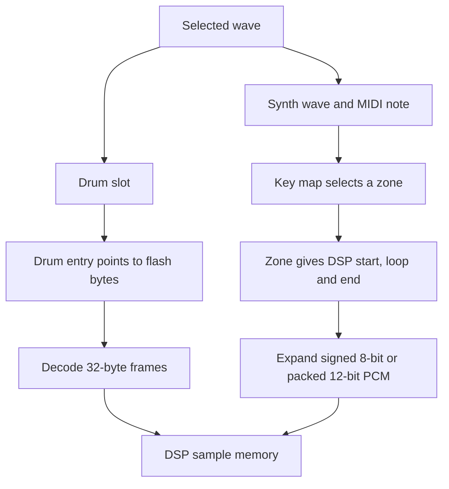

# Inside the Electribe EM-1 firmware and PCM bank

When you select **BD-Dark**, the EM-1 can find the whole drum sound from one 16-byte entry. When you select **Saw-ProSynth**, it first needs the note you played. The firmware uses that note to choose one of ten sample zones. That difference explains both the layout of the bank and why replacing a single synth wave takes more care than replacing a kick.

These notes describe the captured **Code ROM 1.02** and **factory PCM 2.00** from the original EM-1. Firmware addresses refer to that code revision. Examples use the factory layout. A rebuilt bank can move its sample data.

## From two MIDI captures to a memory map

The starting point was tracelistener’s EM-1 Mute Mod. Its backup tool already used the instrument’s **out** service mode to read the Code ROM. We adapted that procedure for an EM-1 running 1.02. Korg’s service manual identifies the Hitachi HD6412350 H8S CPU, two external flash devices, and TI TMS57070 DSP on the board. The readback procedure came from the prior tool. The PCM field definitions came from the captures and the instructions that use them. [Upstream Mute Mod](https://github.com/tracelistener/tracelistener-em1-mute-mod) · [EM-1 service manual, parts list](https://device.report/m/b43eafdfa2d940168d868e7155ea400144b4f908c4cd9ad250b5f7b349654596)

| What was captured | How it was selected | Decoded image |
| --- | --- | --- |
| Code ROM 1.02 | Power on with **REC + STEP EDIT** held for **out**. Arm Code ROM readback in the host, then press **PLAY** when REC flashes. | 32 blocks × 8,192 bytes = **262,144 bytes** |
| PCM 2.00 | In **out**, arm PCM capture, press **PATTERN** to select PCM 2.00, then **PLAY**. | 392 blocks × 8,192 bytes = **3,211,264 bytes** |

The device announces which image it is sending. Each block has a sequence number and a checksum over its seven-bit MIDI payload. A complete 9,372-byte SysEx frame decodes to 8,192 image bytes. In each packed group, a prefix byte carries the high bits of up to seven following data bytes. Concatenating the **decoded** blocks in order produces the images used below. The firmware and PCM have independent version numbers and image checksums.

### How the code was identified

At Code ROM offset `0x000000`, the first four bytes are `00 00 08 10`. Read as a big-endian reset vector, they point to `0x000810`. Immediately before that entry point, at `0x000800`, the bytes `4B 4F 52 47 01 02 61 00` identify a KORG 1.02 EM-1 code image. Disassembly at the reset target yields H8S startup instructions, including a stack-pointer initialization. The 16-bit word sum over the complete image is zero. The PCM capture has its own KORG header at offset zero, beginning `4B 4F 52 47 02 00 61 02`.

The firmware also contains 8.3-style names for drum and synth parameters and data, including `DRUMPARA`, `DRUMDATA`, `DWGSPARA`, and `DWGSDATA` with a `BIN` extension. Those strings suggested what to look for. Following the instructions that read the tables gave each field a meaning.

| Code address | Observation in the 1.02 disassembly | What it establishes |
| --- | --- | --- |
| `0x01B920–0x01B972` | The drum loader reads a count from `0x0FA9FC`, takes `0x0FF300` as its table base, and loads four 32-bit values at offsets 0, 4, 8 and 12. | Location and shape of a drum entry. Following those values into flash and playback memory distinguishes the two address pairs. |
| `0x017F02–0x017F20` | The synth routine indexes the pointer table at `0x0FAA00` by `wave × 4`, walks four-byte records until the key limit covers the note, then returns the 16-bit value at record offset 2. | The first byte is an **inclusive upper MIDI note**. The returned value selects a zone. |
| `0x017C62–0x017CBE` | The caller multiplies that zone number by 16, loads three longwords from the table at `0x0FB700`, sends them to DSP registers and reads a separate 16-bit gain. | A zone descriptor connects note selection to playback addresses and voice parameters. |
| `0x01B7E0–0x01B832` | The unpacking loop advances its source by six bytes and its destination by eight, extracting four left-aligned sample words. | The upper-precision synth region holds four 12-bit samples in six flash bytes. |

To inspect the note lookup yourself, run GNU Binutils built for the H8S against your decoded 1.02 image. The raw dump contains no symbol names.

```sh
h8300-hms-objdump -b binary -m h8300s -D --start-address=0x17f02 --stop-address=0x17f22 code-1.02.bin
```

At `0x017F14`, `cmp.b r0l,r0h` compares the played note with the record’s ceiling. The next instruction branches on carry clear, which includes equality. Otherwise `adds #4,er1` advances to the next record. That branch tells us exactly which zone plays at a boundary such as MIDI note 51.

The Mute Mod offered a second way to check the disassembly against behavior. In the stock 1.02 transport routine, `sub.w r0,r0` clears a register and the instruction at `0x009294` writes that zero to the live mute mask at `0x40297C`. The Canvas adaptation of tracelistener’s work keeps a copy of the player’s mute choices in RAM and restores it on that path. A simulator test exercised all 1,024 combinations of the eight drum and two synth mutes at seven pattern-apply sites. Restoring the stock clearing instruction made the test fail again.

## Reading the PCM image

The first byte of the PCM file corresponds to **CPU flash address `0x0F0000`**. For a CPU flash pointer, subtract `0x0F0000` to obtain its file offset. The waveform bytes live in external flash. A DSP playback address counts **sample positions** in the DSP’s sample memory, so it needs the appropriate decoding rule below. Multi-byte fields in these tables are big-endian. Stored end addresses are **inclusive**.



| PCM file offset | Meaning in the factory 2.00 image |
| --- | --- |
| `0x000000` | KORG PCM header. Checksum words are at `0x00000A` and `0x00000E`. |
| `0x00A9E8`, `0x00A9EC` | Start of packed 12-bit data in flash (`0x1AFB2E`), and its corresponding DSP sample address (`0x2AFB2E`). |
| `0x00A9F0`, `0x00A9F4` | Last stored synth byte in flash (`0x1FFBDD`), and last synth sample address on the DSP (`0x2E50F6`). |
| `0x00A9F8`, `0x00A9FA`, `0x00A9FC` | 16-bit counts of synth waves (**50**), zone descriptors (**315**) and drum waves (**144**), respectively. |
| `0x00AA00` | 50 four-byte pointers to synth key maps. The first map starts at file offset `0x00AAC8`. |
| `0x00B700` | Synth zone-descriptor table. Each entry occupies 16 bytes. |
| `0x00F300` | Drum table. Each entry occupies 16 bytes. |
| `0x010000` | Synth sample payload begins. Flash `0x100000` corresponds to DSP sample `0x200000`. |
| `0x10FBDE` | First factory drum frame, immediately after the stored synth payload. |

## Following a drum entry into its frames

For panel drum **001, BD-Dark**, table index zero selects file offset `0x00F300`. Its four 32-bit fields supply both ends of the transfer.

| Entry offset | Value | Meaning |
| --- | --- | --- |
| `+0x00` | `0x002E50F8` | First DSP destination sample |
| `+0x04` | `0x002E7E37` | Last DSP destination sample |
| `+0x08` | `0x001FFBDE` | First encoded byte in CPU flash |
| `+0x0C` | `0x0020291D` | Last encoded byte in CPU flash |

Subtracting the bank base gives file offsets **`0x10FBDE–0x11291D`**. Counting both endpoints gives **11,584 bytes**. This is exactly **362 frames**, which decode to **11,584 mono samples**, or **362 ms at 32 kHz**. Drum 002 begins at the very next flash byte, `0x20291E`. Its DSP destination begins at `0x2E8360`, leaving **1,320 sample addresses** between the two drums in playback memory. Packing the flash bytes tightly and preserving the DSP gap are two separate jobs.

### What is in a drum frame?

A 32-byte frame reconstructs 32 signed samples. The first sample is explicit. Each of the next 31 is obtained by adjusting a running prediction. Bit positions below count from the most significant bit of the first byte.

| Bits | Interpretation in the Canvas decoder |
| --- | --- |
| 0–15 | Initial signed 16-bit sample, also the starting prediction. |
| 16–21, 22–27 | Initial step-table index and minimum index within the selected 64-entry bank. |
| 28–31, 32–33 | Predictor-range exponent and selection of one of four step-table banks. |
| 34–38 | All zero in the **65,316 factory frames** checked. Canvas handles a nonzero value as silence. Its original hardware meaning is unverified. |
| 39–255 | 31 seven-bit codes, each containing one sign bit and six magnitude bits. |

For magnitude `m`, the decoder computes `floor(step × (2m + 1) / 64)`. It adds or subtracts that delta, clamps the result, and updates the step index. Additional rules near the predictor limits matter for sample-exact output. Each frame starts from its own seed. The storage ratio is **one encoded byte per output sample**. For example, the first BD-Dark frame begins with `00 00 EF BE 40` and decodes to samples beginning `0, 32, 0, 32`. Reading the bytes as signed 8-bit PCM would give a different waveform.

## Following a synth note through its key map

Each synth part selects one of the 50 waves. Both parts can use the same wave. On a fresh note, the H8S walks that wave’s key map. Each record contains an upper MIDI note, a byte that is zero in the factory maps, and a big-endian 16-bit zone ID. The final upper limit is 127.

For **synth wave 001, Saw-ProSynth**, the pointer at `0x00AA00` is `0x000FAAC8`, so the map starts at file offset `0x00AAC8`.

| First map records | MIDI notes covered | Zone selected |
| --- | --- | --- |
| `33 00 00 00` | 0–51 | 0 |
| `3B 00 00 01` | 52–59 | 1 |
| `47 00 00 02` | 60–71 | 2 |

**Take MIDI note 48.** The first record covers it. Zone 0 therefore lives at `0x00B700 + 16 × 0`. The firmware reads the following fields there.

| Entry offset | Field | Zone 0 |
| --- | --- | --- |
| `+0x00` | First DSP sample address | `0x002B469E` |
| `+0x04` | Loop offset in samples from the start | `0x000000FA` = 250 samples |
| `+0x08` | Inclusive last DSP sample address | `0x002B4A47` |
| `+0x0C` | Root pitch in units of 1/256 semitone | `0x1E1F / 256` = MIDI note 30.12109375 |
| `+0x0E` | Unsigned gain, with `0xFFFF` at unity in Canvas | `0xF850` |

This zone spans **938 samples**. The key limit tells the synth *when to select it*. The fractional root tells the synth *how to pitch it*. That is why a wave can change character at a key boundary while staying in tune.

### Locating the samples

- **Below the DSP split**, source bytes are signed 8-bit PCM. The file offset is `0x010000 + (address − 0x200000)`. Multiply the signed value by 256 for Canvas’s 16-bit representation.
- **At or above the split**, count forward from the packed-data pointer. If `k = address − split`, the pair begins at `(packedFlash − 0x0F0000) + 3 × floor(k / 2)`. For bytes `a, b, c`, decode the even sample as `(a << 4) | (b >> 4)` and the odd sample as `((b & 15) << 8) | c`. Sign-extend each from 12 bits and multiply by 16.

For the example above, `0x2B469E − 0x2AFB2E = 0x4B70`. That is an even index, and its three-byte pair starts at file offset **`0x0C6C56`**. The bytes there are `13 F7 FF`. They decode to 12-bit values `0x13F` and `0x7FF`, or **5,104** and **32,752** as signed 16-bit samples. This completes the path from a played MIDI note to actual audio values.

## Why some replacements fit and others need a bank write

**A drum owns an encoded span.** Canvas measures the proposed sound in whole 32-sample frames. A single-slot write can use the entire known reservation, including an exact fit. Replacing a long kick with a short one updates both end addresses, zeroes the unused tail, and keeps the old reservation in Canvas’s bank reference. Sending a cleared slot writes silence. A full repack can allocate that space elsewhere.

**A synth wave can share its PCM with another wave.** In the factory bank, Saw-ProSynth’s zone **5** and Pulse 15%-MG’s zone **25** have distinct descriptors, but both point to DSP samples **`0x2CE9FB–0x2CEB7B`**. Writing there changes both waves. Canvas accounts for shared ranges, available descriptors and map records, and separate 8-bit and 12-bit capacity. A new single-slot synth replacement also needs five spare sample positions under Canvas’s fit rule. An exact match can be resent. Reducing a key range helps when it removes entire zones.

**Flash is erased in sectors.** A transfer block is 8 KiB, and an erase sector can contain several blocks. In the reference **707 kick** replacement for drum 001, only blocks `0, 135, 136, 137` differ from the factory image. The write covers **18 blocks** in the order 128–135, 136–137, then 0–7. The sample crosses a flash-sector boundary, and block 0 contains the bank checksums. Sending the neighboring bytes from a known device image preserves them when their sectors are erased.

Canvas checks two 16-bit big-endian sums. The words in file range `[0, 0x110000)` must sum to zero modulo 65,536. The words in `[0x110000, 0x310000)` plus the first 12 header bytes must also sum to zero modulo 65,536. These image checks are separate from the seven-bit checksum on each MIDI frame.

## What was verified

- **Captured bytes.** All 144 factory drums were decoded from the encoded bank and compared sample-for-sample with the WAV audio used by Canvas. All matched. Decoding the samples addressed by all 315 synth descriptors also matched the expanded synth PCM. Of those zones, 151 use 8-bit storage and 164 use packed 12-bit storage. The WAVs and expanded PCM are project reference decodes of this capture.
- **Original firmware in simulation.** The actual 1.02 H8S key-selection routine returned the expected zone for every combination of 50 waves and 128 MIDI notes. The original unpacking loop also converted a synthetic six-byte fixture into four expected signed sample words, including both 12-bit extremes.
- **Physical playback.** Testing on an EM-1 included the 707 drum replacement, a complete custom sample-bank upload, and an imported JD-990 sine wave played across octaves and checked with a tuner. These tests establish playback and pitch tracking for the material tried.
- **Browser playback.** The release uses native C++/WebAssembly playback and extracted numerical voice tables. It can audition a bank before you capture a Code ROM. Effects and delay are bypassed in this release.

### Reproduce the lookup with your own PCM capture

This read-only Python example takes the **decoded factory PCM 2.00 binary** as its argument. It follows note 48 through the first synth map and prints the descriptor. On the factory image the expected result is zone 0, DSP range `0x2b469e–0x2b4a47`, loop offset 250, and root 30.12109375.

```python
from pathlib import Path
import struct
import sys

bank = Path(sys.argv[1]).read_bytes()
if len(bank) != 0x310000 or bank[:8] != bytes.fromhex("4b 4f 52 47 02 00 61 02"):
    raise ValueError("Expected a decoded EM-1 PCM 2.00 image")

wave, note = 0, 48
pointer, = struct.unpack_from(">I", bank, 0xAA00 + 4 * wave)
map_offset = pointer - 0x0F0000
if not (0xAAC8 <= map_offset < 0xB700 and map_offset % 4 == 0):
    raise ValueError("Invalid key-map pointer")

zone_count, = struct.unpack_from(">H", bank, 0xA9FA)
for offset in range(map_offset, 0xB700, 4):
    upper_note, reserved, zone = struct.unpack_from(">BBH", bank, offset)
    if reserved or upper_note > 127 or zone >= zone_count:
        raise ValueError("Invalid key-map record")
    if note <= upper_note:
        start, loop, end, pitch, gain = struct.unpack_from(">IIIHH", bank, 0xB700 + 16 * zone)
        print(f"Zone {zone}, DSP {start:#x}–{end:#x}, loop {loop}, root {pitch / 256}")
        break
else:
    raise ValueError("No matching zone")
```

| Reference image | SHA-256 of the decoded binary |
| --- | --- |
| Code ROM 1.02 | `517a3906c46ddd36eae55cd77f5427a6d5c4e2c674538d6e4911af4bd6a6f214` |
| Factory PCM 2.00 | `a41beeba29eb2675a64b6f6732b36c4cc05e97b26ce58e4532f8430d4eadf453` |

Implementation landmarks in [EM-1 Canvas](./index.html) include `decodeBlock` for transport, `EM1Bank.decodeFrame` for drums, and `ROMSynBank.inspect`, `readSample`, and `fit` for synth layout and allocation. For the panel and transfer workflow, see the [operating guide](./README.md).
