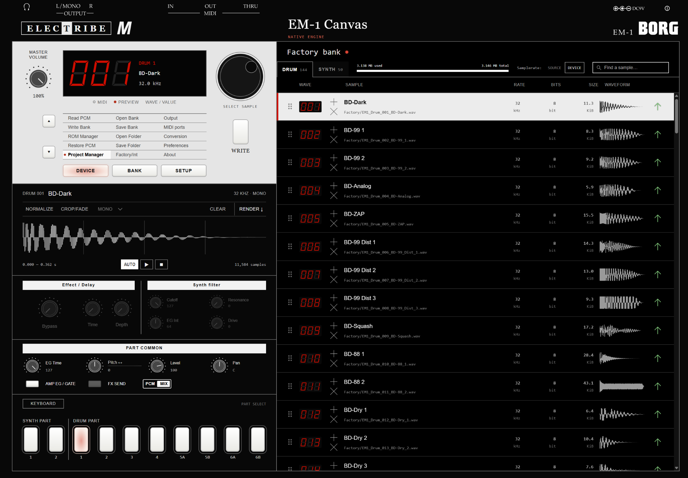

# EM-1 Canvas beta v1.0.0

EM-1 Canvas is a sample editor and MIDI librarian for the Korg Electribe EM-1. Open the [index.html](./index.html) in desktop Chrome or Edge to play the factory sounds, build a sample bank, or work with a connected EM-1. On GitHub, use **Download raw file** to get the HTML.

The Browser app was tested and confirmed working using Google Chrome, A Motu M2 Audio interface for midi, and an original Korg Electribe EM-1 running firmware version 1.02. 

## Using the matrix

The matrix has three columns. **DEVICE** transfers data to and from the EM-1, **BANK** manages files on your computer, and **SETUP** controls browser audio and MIDI. Double-click a command to run it. You can also press a column button, move up or down with **▲ / ▼**, and press the button above **WRITE** to run the highlighted command.

### DEVICE

Connect both MIDI cables and choose your ports under **SETUP → MIDI ports**. For **out** mode, hold **REC + STEP EDIT** while powering on. For **IPL**, hold **PATTERN + STEP EDIT** while powering on. Release the buttons when the corresponding word appears on the EM-1 display.

| Matrix slot | How to use it |
| --- | --- |
| **Read PCM** | Capture the sample bank currently installed in the EM-1. In **out** mode, start capture in Canvas, then press **PATTERN** once on the EM-1 to select PCM 2.00 and **PLAY** once to transmit. A complete read refreshes the space available for individual slot uploads. **Download capture** saves a copy. |
| **Write Bank** | Send the entire sample bank currently open in Canvas. Review the prepared bank, put the EM-1 in **IPL**, check the mode box, and choose **Upload bank**. Use this after rearranging slots or when a replacement needs more space. |
| **Fetch ROM / ROM Manager** | Capture the operating system in **out** mode, or use **Load .bin** to open your own backup. After the first capture or import, the slot reads **ROM Manager**. In **IPL** you can read the device version or send the selected firmware. Recognized factory 1.01 and 1.02 images offer a **Mute Mod** that keeps live part mutes across Stop, Play, and pattern changes. |
| **Restore PCM** | Replace the EM-1’s installed samples with the factory drum and synth bank. Review the factory bank shown in the dialog and confirm the upload in **IPL**. To open factory sounds in the editor, use **BANK → Factory/Int**. |
| **Project Manager** | Back up pattern banks A–D, songs, and global settings. Stop playback, enter **Global**, hold **SHIFT** and press step **15** for **Dump**, then choose **Read project from EM-1**. To restore a backup, turn Protect off, open its `.syx`, and choose **Send project to EM-1**. Canvas lists the sections it will overwrite. |

During a transfer, you can close the popup and follow progress in the MIDI bar. Click the bar to reopen the details. Keep the browser tab open and the EM-1 powered until the transfer finishes.

### BANK

| Matrix slot | How to use it |
| --- | --- |
| **Open Bank** | Choose a saved Canvas bank `.json` to restore its samples, slot order, edits, and part settings. |
| **Save Bank** | Download the open bank as one editable `.json` file. It includes source audio, edits, part settings, and any attached project or imported wave ROMs. A red dot beside the bank name marks unsaved changes. |
| **Open Folder** | Choose an extracted Canvas folder containing `bank.json` to reopen the bank with its sources. Choosing an ordinary audio folder imports its supported samples into the source library. |
| **Save Folder** | Download a ZIP containing `bank.json` and the source files. If you’ve read or opened a sequencer project, the folder also includes `project.syx`. Use this to keep a set’s sequences together with the samples they trigger. |
| **Factory/Int** | Choose **Factory bank** to open the original 144 drum slots and 50 synth waves, or **Starter bank** to begin with an empty pool. Both choices act on the editor. |

### SETUP

| Matrix slot | How to use it |
| --- | --- |
| **Output** | Choose where browser auditions play, then click **Set output**. **Reveal devices** lists additional outputs when the browser supports it. Otherwise, select the output in your operating system. |
| **MIDI ports** | Allow MIDI and SysEx access. Select the interface input connected to **EM-1 OUT** and the interface output connected to **EM-1 IN**. Match **Global / Synth 1** to the instrument’s channel and click **Connect**. |
| **Conversion** | Open **Preview settings**, choose 32, 44.1, or 48 kHz for sample preview and WAV rendering, then click **Apply**. Drum samples sent to the EM-1 use 32 kHz. |
| **Preferences** | Opens the same **Preview settings** dialog. Set **Audition on sample selection** to decide whether clicking a pool row plays it, then click **Apply**. |
| **About** | Open the built-in guide to waveform gestures, the preset browser, project and firmware transfers, and how the EM-1 allocates sample memory. |

## Using the sample canvas

The part pads select what you’re playing. The pool on the right holds the bank’s 144 drum slots and 50 synth waves. Select a row to bring its waveform into the editor. Use the Part Common knobs for level, pan, pitch, and envelope while listening. **PCM** monitors the sample signal and **MIX** monitors the mix. Effects and delay are bypassed in this build.

### Replace and edit a drum

1. **Choose the destination.** Select a drum part, open **DRUM** in the pool, and click the row you want to replace. Use **Find a sample** to narrow the list. **SOURCE / DEVICE** switches the displayed sample rate and bit depth between the original and device formats.
2. **Load and listen.** Drop a WAV anywhere over the pool to replace the **selected row**, or click **+** on the destination row to choose a file. Press **Space** to audition and **Esc** to stop. Turn **AUTO** on to hear each row as you select it.
3. **Shape the waveform.** Turn on **CROP/FADE**. The **lower-left and lower-right** corners trim the start and end. The **upper-left and upper-right** corners set the fade-in and fade-out. For stereo audio, select **L + R**, **LEFT**, or **RIGHT**. **NORMALIZE** brings the loudest peak in the retained audio to 0 dBFS. These edits preserve the source file. **RENDER ↓** downloads the edited sound as a mono WAV.
4. **Arrange the pool.** Drag a row by its grip to change slot order. Double-click a sample name to rename it and press **Enter** to finish. The **×** beneath **+** clears the slot. **Ctrl/Cmd + Z** undoes a bank edit.
5. **Save or send.** Use **Save Bank** to keep editing later. To hear one replacement on the hardware, put the EM-1 in **IPL** and click the row’s **send arrow**. If the installed bank may have changed, use **Read PCM** first. An oversized drum offers **Crop** to fit the existing slot. Sending a cleared drum writes silence and preserves its allocation.

### Play and assign a synth wave

Select a synth part and open **KEYBOARD**. Choose **S1** or **S2** and play the on-screen keys. For a synth slot loaded from an audio file, **ROOT** sets the note that plays at the sample’s original pitch, and **LOOP** toggles looping.

For a multisample, open **PRESETS** in the waveform toolbar. Click a wave in the four-column browser to audition it. Click the **+ beside that preset** to assign it to the selected pool slot. A filled multisample slot opens its source bank. Empty and audio-file slots open the last loaded wave bank. Use **JV80…** or **JD-990…** to load your own supported wave ROMs.

Play notes across the keyboard to hear the different zones. **MIN / MAX** set the retained key range. If a synth replacement exceeds its slot allocation, **Constrain key range** can make it fit by dropping zones.

For the binary layout and worked examples of a drum slot and a synth key map, see [Inside the Electribe EM-1 firmware and PCM bank](./EM1_Firmware_and_PCM.md).

## License and sample data

The [MIT license](./LICENSE) covers the original Canvas software and documentation. The [sample data notice](./SAMPLE_DATA_NOTICE.md) explains the factory audio, optional Roland imports, and what a saved bank can contain.

Canvas includes Korg factory sample data. Operating-system firmware comes from your own device or backup. The HTML includes the upstream MIT notice for tracelistener’s transport and mute-mod contributions. [Mute Mod project](https://github.com/tracelistener/tracelistener-em1-mute-mod) · [Korg EM-1 manuals](https://www.korg.com/us/support/download/product/1/97/)

## Credits and sound data

Canvas builds on tracelistener’s EM-1 transport and mute-mod work. The HTML includes the upstream MIT notice for those contributions. [tracelistener’s EM-1 Mute Mod](https://github.com/tracelistener/tracelistener-em1-mute-mod)

This build includes Korg factory PCM and derived wave data. The Code ROM comes from the owner’s device or backup. Saved Canvas banks can also contain imported wave ROMs, see SAMPLE_DATA_NOTICE.md for more information.

## Development and testing

I developed EM-1 Canvas with OpenAI’s Codex. I designed the sample-editing workflow and panel interactions, chose how the editor should work with the hardware, and tested it on my Korg Electribe EM-1. Codex helped me analyze firmware captures, interpret the PCM format, write and revise the application, build automated tests, and draft the documentation.

I verified a complete custom sample-bank upload on my EM-1 and checked an imported JD-990 sine wave across octaves with a tuner. The firmware and PCM guide identifies which other findings came from captured bytes, browser tests, or firmware simulation.

[Original Korg EM-1 owner’s manual and MIDI implementation](https://www.korg.com/us/support/download/product/1/97/)